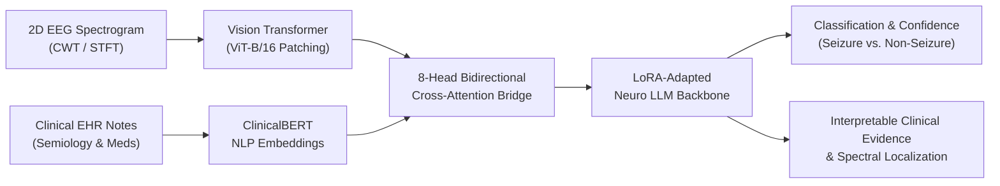

# Neuro LLM — AI-Powered Epileptic Seizure Detection

[](https://react.dev/)
[](https://vitejs.dev/)
[](https://tailwindcss.com/)
[](LICENSE)

A Multimodal Neuro LLM research prototype bridging continuous physiological electroencephalogram (EEG) spectrograms with unstructured clinical EHR semiology through bidirectional cross-attention foundation AI.

---

## 🧠 Overview

Standard automated seizure detection algorithms analyze raw 1D traces or spectrograms in isolation, frequently resulting in false alarms from muscle twitches, electrode movements, and ICU equipment artifacts. 

**Neuro LLM** combines computer vision (Vision Transformers) and clinical natural language processing (ClinicalBERT) with a Large Language Model backbone to align continuous 2D time-frequency spectrograms with patient medical history, event semiology descriptions, and anti-seizure medication (ASM) context.

### Key Capabilities
- **Multimodal Cross-Attention Alignment**: Fuses 2D visual spectral patch tokens with patient clinical narratives.
- **Artifact Discrimination**: Suppresses benign artifacts by contextualizing electrographic abnormalities with clinical semiology.
- **Explainable Clinical Evidence**: Provides calibrated confidence intervals, frequency band localization, and structured reasoning summaries.
- **Client-Side Privacy (HIPAA-Aligned)**: Local simulation with zero remote data retention.
- **Multi-Persona Authentication**: Instant 1-click profiles for Chief Epileptologists, Neuro-AI Researchers, and ICU Technologists.
- **Full-Width Responsive UI**: Designed for widescreen clinical monitors and multi-window ICU dashboards.

---

## 🛠️ Architecture & Pipeline



---

## 🚀 Getting Started

### Prerequisites
- [Node.js](https://nodejs.org/) (v18.0 or higher recommended)
- `npm` or `yarn`

### Installation

1. **Clone the repository**:
   ```bash
   git clone https://github.com/VeerChaurasia-01/Neuro-llm.git
   cd Neuro-llm
   ```

2. **Install dependencies**:
   ```bash
   npm install
   ```

3. **Start the development server**:
   ```bash
   npm run dev
   ```
   Open [http://localhost:5173](http://localhost:5173) in your browser.

4. **Build for production**:
   ```bash
   npm run build
   ```

---

## 📂 Project Structure

```
neuro-llm/
├── public/
│   ├── favicon.svg
│   ├── hero-brain.png
│   └── sample-spectrogram.png
├── src/
│   ├── assets/
│   ├── components/
│   │   ├── about/            # Research pipeline architecture breakdown
│   │   ├── analyze/          # EEG dropzone, clinical form, analyze button
│   │   ├── auth/             # Modal & evaluator profile dropdown
│   │   ├── history/          # In-memory session audit log table
│   │   ├── layout/           # Full-width Navbar & Footer
│   │   └── results/          # Classification, confidence & evidence cards
│   ├── constants/            # Presets & sample medical clinical cases
│   ├── context/              # AnalysisContext & AuthContext
│   ├── pages/                # Home, Analyze, History, About
│   ├── App.jsx
│   ├── index.css
│   └── main.jsx
├── package.json
├── tailwind.config.js
└── vite.config.js
```

---

## 🩺 Clinical Disclaimer

This software is an academic demonstration and research prototype. It is not approved as a medical device for autonomous diagnostic purposes. All clinical evaluations require verification by board-certified neurologists, epileptologists, and qualified healthcare professionals.

---

## 📄 License

This project is open-source and available under the [MIT License](LICENSE).
